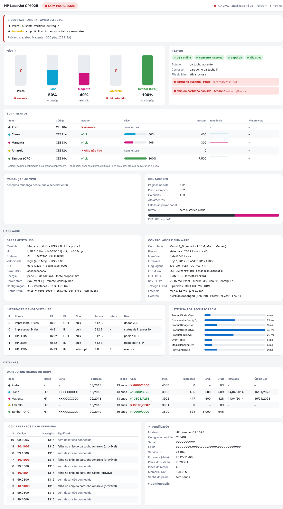
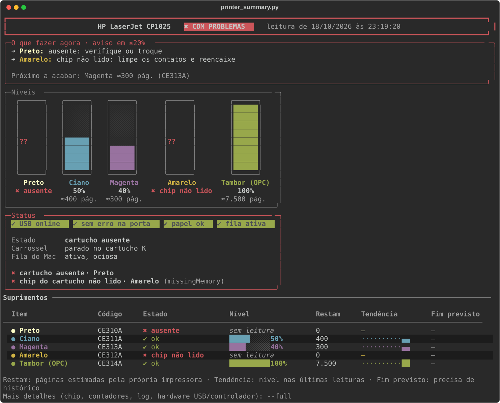
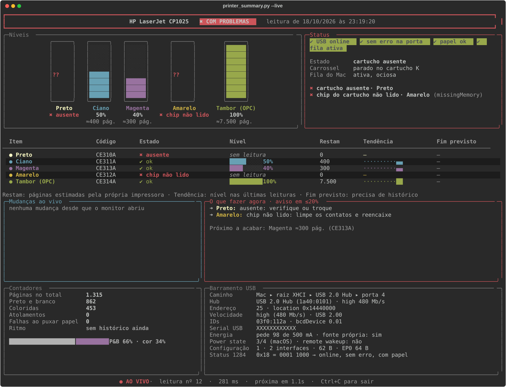
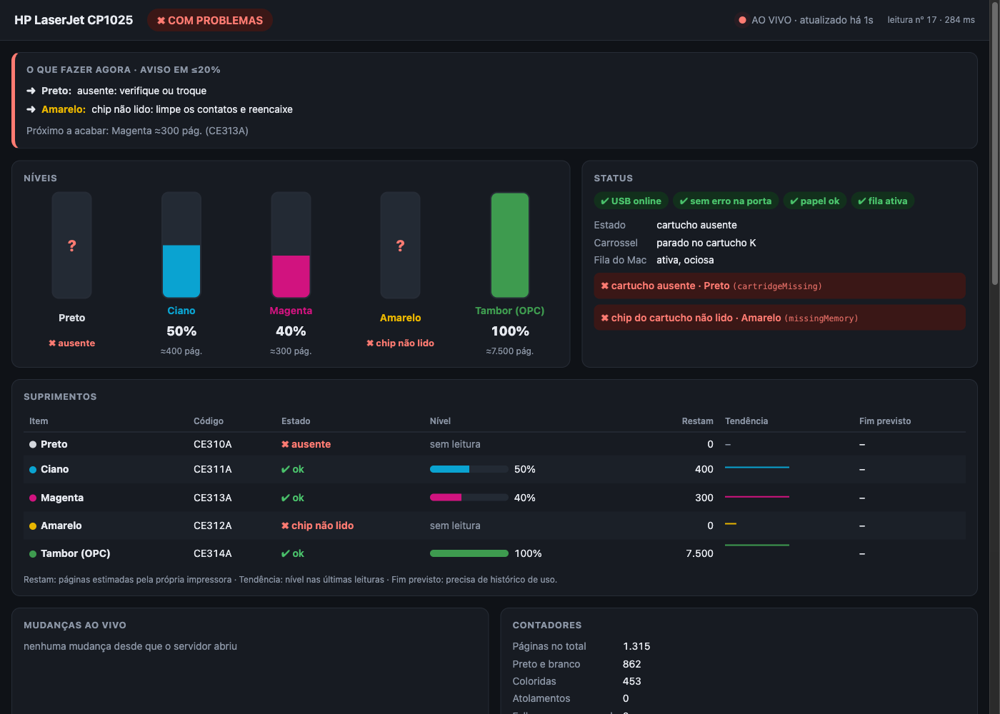
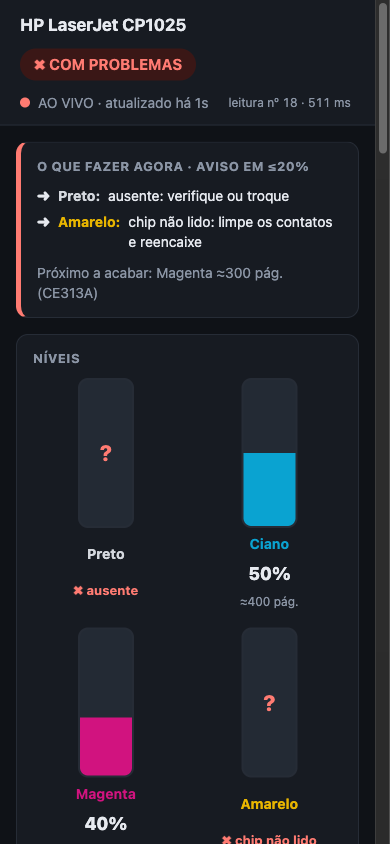

# hp-cp1025-monitor

Low-level status monitor for the **HP LaserJet CP1025** over USB on macOS. It talks to the printer directly with libusb, reads HP's LEDM interface (HTTP tunnelled over a vendor USB interface), and shows toner levels, cartridge chip data, counters, the printer's event log and the USB/controller hardware in a terminal UI or a live web page.

No HP software is needed to read the status. The printer does not need to be able to print.



## Why

The CP1025 is a host-based printer (ZJS). On macOS 14 the last HP driver Apple shipped (HP Printer Drivers 5.1.1) installs only after patching its macOS version check, and its `hpcp1020` filter then produces blank pages. There was also no way to see why the printer refused jobs. This project reads the answer straight from the printer: in this case, cartridge chip errors.

See [docs/FINDINGS.md](docs/FINDINGS.md) for everything that was found along the way.

## Status

Monitoring works (terminal and web, about 250 ms per full reading). Printing on the author's unit is still blocked by two cartridges: the black chip is unreadable and the yellow chip is rejected. The ordered next steps, and what is still unverified, are in [docs/FINDINGS.md](docs/FINDINGS.md#still-open-in-order).

## Requirements

- macOS (tested on 14.6.1, Intel). The USB topology panel uses `ioreg`; everything else is plain libusb.
- Python 3.10+ (tested with 3.11)
- `libusb-1.0` (`brew install libusb`)
- `rich` for the terminal UI (`pip install -r requirements.txt`)

The CUPS queue name in `printer_model.py` (`QUEUE_NAME`) is only used to report whether the macOS queue is paused.

## Usage

```bash
python3 printer_summary.py              # one-shot summary: verdict, what to do, levels
python3 printer_summary.py --full       # plus chip data, counters, event log, USB and controller hardware
python3 printer_summary.py --live       # full-screen, re-reads every ~1 s, feed of every change
python3 printer_summary.py --watch 30   # full-screen, re-reads every 30 s
python3 printer_summary.py --web        # live web page on http://127.0.0.1:8025 (--port to change)
python3 printer_summary.py --json       # machine-readable report
```

Exit code: `0` ok, `1` warning (low toner, alerts), `2` error (blocking problem or printer unreadable). Colors follow `NO_COLOR`, `--no-color`, and are dropped when output is piped.

Every reading is appended to `history.jsonl` when something changed. With at least one day of usage history the dashboard estimates pages per day and when each toner runs out.

### Terminal

`printer_summary.py`



`printer_summary.py --live`



`--full` output: [docs/screenshots/terminal-full.svg](docs/screenshots/terminal-full.svg)

### Web

The web page is served by the Python standard library, bound to `127.0.0.1` only, read-only. One thread owns the USB link; every browser tab gets each new reading through Server-Sent Events (`/events`), and `/api/status` returns the latest reading as JSON. The page is plain HTML/JS with no external assets, and follows the system light/dark setting.

| Dark | Phone |
|---|---|
|  |  |

Device serial numbers and the UUID are masked in all screenshots.

## What it reads

| Source | How | Data |
|---|---|---|
| IEEE 1284 printer class | USB control requests `GET_DEVICE_ID`, `GET_PORT_STATUS` | device id string, online / error / paper-out bits |
| USB descriptors | control requests on EP0 | USB version, speed, power draw, every interface and endpoint |
| HP LEDM | HTTP/1.1 over USB interface 1 (class `ff/04/01`), bulk EP `0x02` / `0x82` | status and alerts, consumables, usage counters, product config, event log, media and print settings |
| macOS IORegistry | `ioreg -a -p IOUSB -l` | hub chain, USB address, port, location id, bus power available, power state |
| CUPS | `lpstat -p` | whether the macOS queue is paused and why |

LEDM resources used: `ProductStatusDyn`, `ConsumableConfigDyn`, `ProductUsageDyn`, `ProductConfigDyn`, `ProductLogsDyn`, `EventMgmt/EventTable`, `MediaHandlingDyn`, `PrintConfigDyn`. The printer lists all 25 it supports at `/DevMgmt/DiscoveryTree.xml`.

## Layout

Dependencies point one way: transport, then reading, then polling, then the two front ends, which share one source of wording.

```
hpstatus (UsbPrinter, LedmClient)  ->  printer_model (PrinterReader -> Report)  ->  poller (Poller -> Reading)
                                                                                     |-> dashboard (rich)  \
                                                                                     |-> web_dashboard     -> viewmodel
```

| File | Role |
|---|---|
| `hpstatus.py` | USB transport: `UsbPrinter` owns the libusb handle (descriptors, IEEE 1284 requests, bulk transfers, context manager); `LedmClient` speaks HTTP over the LEDM interface. Also a small CLI to dump any LEDM path. |
| `macos_usb.py` | where the printer sits on the Mac's USB tree, from `ioreg -a` |
| `printer_model.py` | `PrinterReader` takes every I/O source as an argument and builds a `Report`; `Consumable`, `Severity`, change detection, LEDM parsing |
| `history.py` | `history.jsonl` snapshots, sparklines, toner run-out forecast |
| `poller.py` | `Poller.tick()`: one reading, history, diff and adaptive cadence, returned as a `Reading`. Shared by `--live`, `--watch`, the one-shot modes and the web server |
| `viewmodel.py` | every Portuguese string, formatter and panel row, and the web payload. No rendering library |
| `dashboard.py` | `rich` terminal rendering only |
| `web_dashboard.py` + `dashboard.html` | local web server (SSE) and the page, which only lays out pre-formatted strings |
| `printer_summary.py` | CLI entry point |
| `test_printer_summary.py` | tests; run with `python3 test_printer_summary.py` (no printer needed: USB, `ioreg` and `lpstat` are faked) |

Dump a raw LEDM resource:

```bash
python3 hpstatus.py /DevMgmt/ConsumableConfigDyn.xml
```

## Limits

- Only the CP1025 (USB `03f0:112a`) was tested. Other LEDM printers over USB may work with a different `PRODUCT_ID`.
- Event codes `10.100X` are labelled as a likely cartridge chip error from HP forum and support material for other models, not from CP1025 documentation. The `99.xxxx` codes in the log have no known meaning yet.
- The run-out forecast needs real usage history; it stays empty until the printer has printed over at least a day.
- Printing itself is not part of this repo. See [docs/FINDINGS.md](docs/FINDINGS.md) for the working foo2zjs pipeline.
